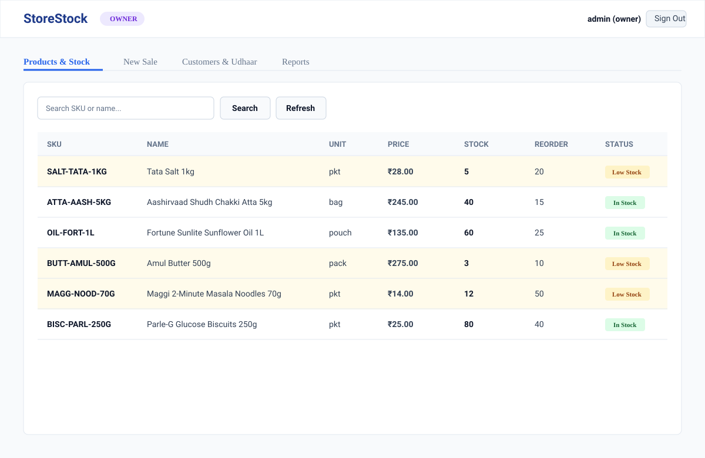

# StoreStock

A production-ready, single-store inventory, point-of-sale, customer credit (udhaar), and purchase-order management REST API built with FastAPI, standard library SQLite (`sqlite3` with plain SQL and zero ORM), Pydantic v2, and PyJWT.

---

## Features

- **Authentication & Role-Based Access Control**: Scrypt password hashing with per-user salts, constant-time verification (`hmac.compare_digest`), PyJWT tokens with live database user validation on every request (immediate revocation and role synchronization).
- **Product & Inventory Management**: Case-insensitive SKU indexing, ASCII-only numeric validation, Excel BOM-safe CSV bulk import with 1 MB request cap, search with wildcard escaping (`%`, `_`), and automatic cost masking for staff.
- **Append-Only Ledgers & Dynamic Stock**: Inventory quantities are computed dynamically from `stock_movements`. Physical adjustments by store owners are logged to an append-only `audit_log`. Database triggers block any `UPDATE` or `DELETE` on stock movements.
- **Atomic Sales & Returns**: Concurrency-safe transactions (`BEGIN IMMEDIATE`) ensuring stock never drops below zero. Historic unit price and unit cost are frozen at sale time. Full and partial return tracking with validation against original sale quantities.
- **Customer Credit (Udhaar Ledger)**: Append-only credit ledger tracking credit purchases, repayments, and returns. Real-time balance calculation with credit limit enforcement and overpayment rejection. Returns on credit sales cleanly reflect as advance customer credit.
- **Suppliers & Purchase Orders**: Complete PO state machine (`draft` -> `sent` -> `partially_received` -> `received`, or `draft`/`sent` -> `cancelled`). Automated restock suggestion formula `max(reorder_level * 2 - current_stock, 1)`. Receiving deliveries increments inventory through immutable delivery movements.
- **Business Reports & Profit Metrics**: Owner-only daily summaries partitioned by Asia/Kolkata local day boundaries. Net sales, net Cost of Goods Sold (COGS), gross profit, top-selling products by date range, customer credit exposure, and inventory valuation.

---

## Project Structure

```text
StoreStock/
├── app/
│   ├── config.py             # Environment configuration (STORESTOCK_* settings)
│   ├── db.py                 # SQLite connection manager, WAL mode, transaction helpers
│   ├── deps.py               # Authentication and database dependencies
│   ├── main.py               # FastAPI application entrypoint and router registration
│   ├── schema.sql            # 13 tables, view, append-only triggers, optimized indexes
│   ├── security.py           # Scrypt hashing and PyJWT token generation/decoding
│   ├── models/               # Pydantic v2 request and response schemas
│   ├── routers/              # API endpoints organized by domain
│   └── services/             # Core business logic and database queries
├── scripts/
│   ├── create_owner.py       # CLI utility to bootstrap initial owner
│   └── seed.py               # Demo database seeder
├── tests/                    # 124 comprehensive pytest integration tests
├── requirements.txt          # Pinned dependency versions
└── README.md
```

---

## Setup & Installation

### 1. Requirements
- Python 3.12 or higher.

### 2. Environment Setup
Clone the repository and set up a virtual environment:

```bash
python -m venv .venv
# Windows:
.venv\Scripts\activate
# Linux/macOS:
source .venv/bin/activate

pip install -r requirements.txt
```

### 3. Environment Variables
Configure the application through environment variables (optional defaults shown below):

| Variable | Description | Default |
|---|---|---|
| `STORESTOCK_DB_PATH` | Path to SQLite database file | `storestock.db` |
| `STORESTOCK_JWT_SECRET` | Secret key for JWT signature | `storestock-insecure-secret-key-change-in-production` |
| `STORESTOCK_JWT_ALGORITHM` | JWT signing algorithm | `HS256` |
| `STORESTOCK_JWT_EXPIRATION_HOURS` | Token validity duration | `8` |
| `STORESTOCK_HOST` | Server host binding | `0.0.0.0` |
| `STORESTOCK_PORT` | Server port binding | `8000` |

### 4. Create Initial Owner Account
Initialize the database and create the first store owner:

```bash
python -m scripts.create_owner --username admin --password "StrongAdminPassword123"
```

### 5. Seed Demo Data (Separate Database)
To explore StoreStock with sample products, customers, suppliers, a purchase order, and initial transactions without affecting your primary database, use a separate database file such as `demo.db`:

```powershell
# Set database path to demo.db
$env:STORESTOCK_DB_PATH = "demo.db"

# Note: scripts/seed.py will refuse to run if products already exist.
# If you wish to re-seed demo.db, delete the file first:
# Remove-Item demo.db -ErrorAction SilentlyContinue

python -m scripts.seed
```

> [!WARNING]
> Seed credentials (`owner` / `owner123` and `staff` / `staff123`) are provided for demonstration purposes only. Never use demo passwords in production.
> `scripts/seed.py` will refuse to run if the `products` table already contains data.

### 6. Run the Application
Start the development server with Uvicorn in PowerShell:

```powershell
$env:STORESTOCK_DB_PATH = "demo.db"
uvicorn app.main:app --host 127.0.0.1 --port 8000 --reload
```

---

## "Try It Yourself" Walkthrough

You can test and explore StoreStock via the **Minimal Web UI (`/app`)**, the **OpenAPI Documentation (`/docs`)**, or from **Windows PowerShell**.

### Option A: Minimal Web UI (`/app`)
StoreStock includes a clean, single-page application built with plain HTML, CSS, and vanilla JavaScript (served directly from `app/static/` without external dependencies or build steps).

1. Open your browser and navigate to [http://127.0.0.1:8000/app](http://127.0.0.1:8000/app).
2. Sign in with either:
   - **Store Owner**: Username `owner`, Password `owner123`
   - **Staff Member**: Username `staff`, Password `staff123`
3. Explore the dashboard tabs:
   - **Products & Stock**: Search items by SKU/name, inspect live quantities, and view amber **Low Stock** highlights for products at or below their reorder level (staff never sees wholesale acquisition cost).
   - **New Sale**: Point-of-sale checkout builder with product dropdown, quantity inputs, live rupee subtotal calculations, and cash vs. credit payment options (with clear HTTP 409 conflict notifications on out-of-stock items or exceeded credit limits).
   - **Customers & Udhaar**: View customer accounts, inspect live udhaar balances, review reverse-chronological transaction ledgers, and record partial repayments.
   - **Reports (Owner Only)**: Dedicated financial dashboard with an Asia/Kolkata date picker showing gross/net sales, Cost of Goods Sold (COGS), gross profits, top-selling volume, total customer credit risk, and inventory valuations.



### Option B: Interactive OpenAPI Documentation (`/docs`)
1. Open your browser and navigate to [http://127.0.0.1:8000/docs](http://127.0.0.1:8000/docs).
2. Expand the `POST /auth/token` endpoint, click **Try it out**, enter username `owner` and password `owner123`, and click **Execute**. Copy the `access_token` from the response.
3. Scroll to the top of the page, click the green **Authorize** button, paste the token into the value field, and click **Authorize**.
4. You can now execute any endpoint directly from the browser UI (e.g., browse products, record sales, review credit ledgers, and query financial reports).

### Option C: Windows PowerShell (`Invoke-RestMethod`)

#### 1. Authenticate and Save Authorization Header
```powershell
$auth = Invoke-RestMethod -Uri "http://127.0.0.1:8000/auth/token" -Method Post -ContentType "application/json" -Body '{"username":"owner","password":"owner123"}'
$token = $auth.access_token
$headers = @{ Authorization = "Bearer $token" }
```

#### 2. Check Restock Suggestions (Items At or Below Reorder Level)
```powershell
Invoke-RestMethod -Uri "http://127.0.0.1:8000/purchase-orders/suggest" -Method Post -Headers $headers
```

#### 3. Record a Counter Cash Sale
```powershell
$saleBody = @{
    payment_type = "cash"
    items = @(
        @{ product_id = 1; qty = 2 }
    )
} | ConvertTo-Json

Invoke-RestMethod -Uri "http://127.0.0.1:8000/sales" -Method Post -Headers $headers -ContentType "application/json" -Body $saleBody
```

#### 4. Record Customer Udhaar Repayment
```powershell
$payBody = @{
    amount_paise = 50000
    note = "Counter cash repayment"
} | ConvertTo-Json

Invoke-RestMethod -Uri "http://127.0.0.1:8000/customers/1/payments" -Method Post -Headers $headers -ContentType "application/json" -Body $payBody
```

#### 5. Check Customer Live Balance
```powershell
Invoke-RestMethod -Uri "http://127.0.0.1:8000/customers/1/balance" -Method Get -Headers $headers
```

#### 6. View Today's Financial Summary Report
```powershell
Invoke-RestMethod -Uri "http://127.0.0.1:8000/reports/daily-summary" -Method Get -Headers $headers
```

---

## Key Design Decisions

1. **Standard Library `sqlite3` without ORM**
   - Direct SQL control ensures atomic execution, transparent locking, and minimal overhead.
   - All complex multi-row workflows (such as counter checkout, delivery receipts, and refunds) use explicit `BEGIN IMMEDIATE` transactions.

2. **Concurrency & Locking Architecture**
   - Write-Ahead Logging (`PRAGMA journal_mode = WAL;`) allows concurrent readers to operate without being blocked by writers.
   - A 5-second busy timeout (`PRAGMA busy_timeout = 5000;`) prevents database locks during overlapping transactions.

3. **Immutable Ledgers with Trigger Protection**
   - `stock_movements`, `credit_entries`, and `audit_log` tables are protected by SQLite triggers that abort any `UPDATE` or `DELETE` statements.
   - Current on-hand stock and customer balances are computed on demand using `COALESCE(SUM(...), 0)` rather than mutable counters.

4. **Historic Price and Acquisition Cost Freezing**
   - Both `unit_price_paise` and `unit_cost_paise` are permanently recorded in `sale_items` at checkout.
   - Subsequent changes to product catalogue prices or wholesale costs never alter past sale receipts, historical COGS, or gross margin reports.

5. **Local Kolkata Day Boundaries**
   - Reporting queries map requested calendar dates (`YYYY-MM-DD`) to exact UTC bounds matching midnight-to-midnight in `Asia/Kolkata` local time.
   - Transactions recorded late at night correctly land on the store's local business day.

6. **Return Accounting Policy**
   - Sales returns are recorded as independent events on the **return date**, not retroactively applied to the original sale date.
   - Daily summaries account for refunds issued and merchandise cost reversed on the day the return occurs, preserving historical register balances.

7. **Strict Role-Based Confidentiality**
   - Staff accounts can view catalogue items and receive purchase orders, but financial cost metrics (`cost_paise`, `unit_cost_paise`) and reports are omitted or forbidden (HTTP 403).

---

## Known Limitations

- **Single-Store Architecture**: StoreStock is designed specifically for single-store retail operations with local SQLite storage; multi-warehouse or distributed store setups are out of scope.
- **Partially Received Purchase Orders Cannot Be Cancelled**: Once physical stock has been partially received and booked into inventory (`partially_received` status), the purchase order cannot be transitioned to `cancelled`. Any remaining quantity must either be delivered or closed out.
- **Serialized Write Throughput**: While SQLite WAL mode permits concurrent readers, write transactions are serialized (`BEGIN IMMEDIATE`). High-throughput multi-terminal checkout environments with dozens of concurrent writes per second would require migrating to a server-based RDBMS such as PostgreSQL.
- **Demo Seed Credentials**: Default credentials generated in `scripts/seed.py` are intended solely for testing and local exploration. Production instances must be bootstrapped exclusively using `scripts/create_owner.py` with unique credentials.

---

## Running Tests

Run the full pytest suite:

```bash
python -m pytest -q
```
```text
124 passed, 1 warning in 57.65s
```
